# Products API (ExpressJS + Prisma)

Dikerjakan oleh **Maulana Zaki Putra Zakaria** (NRP 5027251009).

CRUD produk dengan ExpressJS 5, TypeScript, dan Prisma 7. Database PostgreSQL lokal (Docker), tanpa akun cloud.

## Tech Stack

| Bagian | Pilihan |
|---|---|
| Runtime | Node.js 22 |
| Framework | Express 5 + TypeScript (dijalankan dengan `tsx`) |
| ORM | Prisma 7 + `@prisma/adapter-pg` |
| Database | PostgreSQL 16 lokal (Docker Compose) |
| Lainnya | `dotenv` |

## Struktur Database

| Tabel | Isi |
|---|---|
| `Product` | id (auto increment), name, price (bilangan bulat), createdAt |

## Struktur Project

```
├── prisma/
│   ├── migrations/        # hasil prisma migrate dev
│   ├── schema.prisma
│   └── seed.ts            # data awal: Buku dan Pulpen
├── src/
│   ├── config/prisma.ts
│   ├── controllers/productController.ts
│   ├── middlewares/       # logger.ts, error.ts
│   ├── routes/            # index.ts, product.routes.ts
│   ├── utils/             # http-error.ts, parse.ts, response.ts
│   └── index.ts
├── postman/               # collection Postman (19 test case)
├── docker-compose.yml     # PostgreSQL lokal
├── prisma.config.ts
└── .env.example
```

## Cara Install dan Menjalankan

Butuh Node.js 22 dan Docker.

```bash
docker compose up -d           # jalankan PostgreSQL lokal (port 5432)
npm install
cp .env.example .env
npx prisma generate            # wajib manual di Prisma 7
npx prisma migrate deploy      # membuat tabel
npx tsx prisma/seed.ts         # isi data awal (Buku, Pulpen)
npm run dev                    # http://localhost:3000
```

Cek `http://localhost:3000/health`. Harus muncul `Server dan database OK`.

Perintah lain: `npm run typecheck` dan `npx prisma studio` (lihat isi database di browser). Reset data ke kondisi awal: `npx tsx prisma/seed.ts`.

## Format Response

Sukses:
```json
{ "status": true, "message": "Berhasil mengambil data produk", "data": [] }
```
Gagal:
```json
{ "status": false, "message": "Produk tidak ditemukan" }
```

## Daftar Endpoint

| Method | URL | Body | Status | Keterangan |
|---|---|---|---|---|
| GET | `/products` | - | 200 | Seluruh produk |
| GET | `/products/:product_id` | - | 200 / 404 | Satu produk |
| POST | `/products` | `{ "name", "price" }` | 201 / 400 | Buat produk baru |
| PUT | `/products` | `{ "id", "name", "price" }` | 200 / 400 / 404 | Ubah produk (id di body) |
| PUT | `/products/:product_id` | `{ "name", "price" }` | 200 / 400 / 404 | Ubah produk (id di path, id di body boleh ikut) |
| DELETE | `/products/:product_id` | - | 200 / 404 | Hapus produk |

Validasi: `name` wajib teks tidak kosong, `price` wajib bilangan bulat 0 atau lebih, ID harus bilangan bulat positif (selain itu 400). JSON rusak juga 400.

Contoh PUT:
```json
{ "id": 3, "name": "Penggaris Besi", "price": 4500 }
```

## Bukti Pengujian

Semua bukti diambil dari server yang berjalan di `http://localhost:3000` dengan PostgreSQL lokal. Perubahan database difoto dari **Prisma Studio** (tabel `Product`). Bukti per fitur juga ada di deskripsi Pull Request masing-masing endpoint.

Test case Postman: import `postman/tugasexpress.postman_collection.json` lalu jalankan folder secara berurutan (Runner). Reset data dulu dengan `npx tsx prisma/seed.ts`.

### Database setelah seed
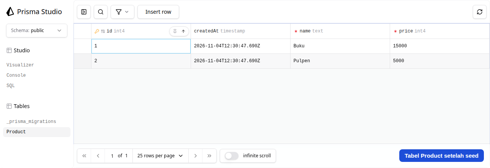

### Health check dan route tidak dikenal
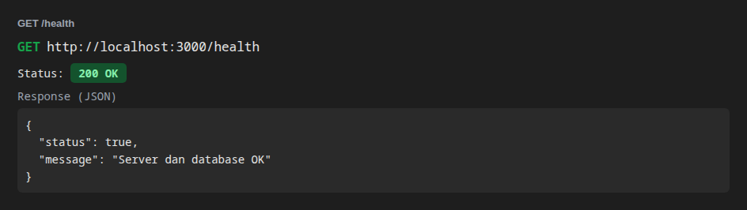
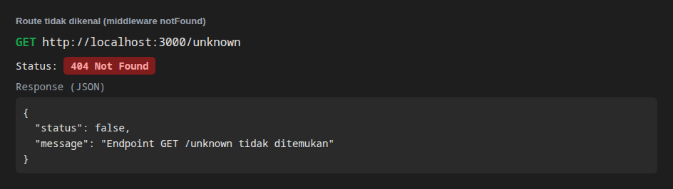

### GET /products
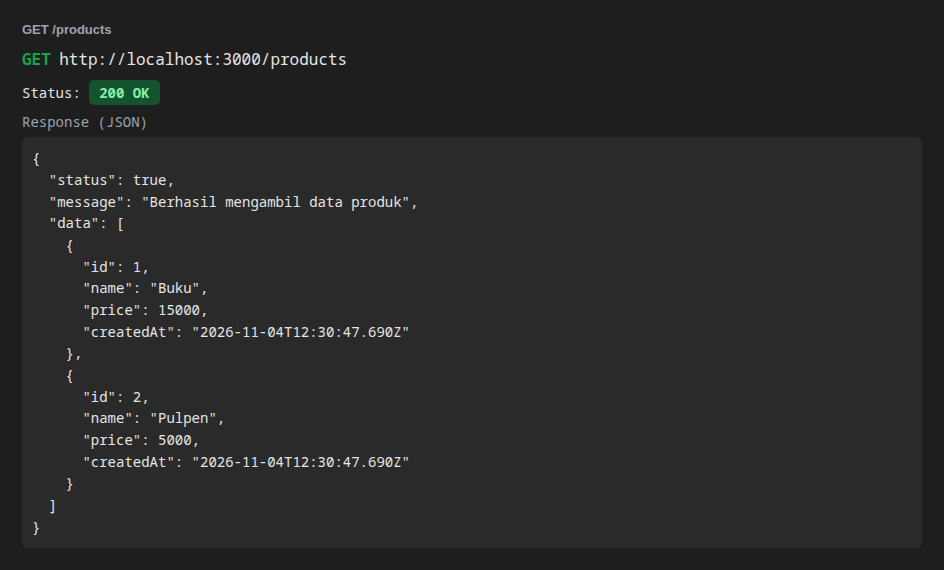

### GET /products/:id
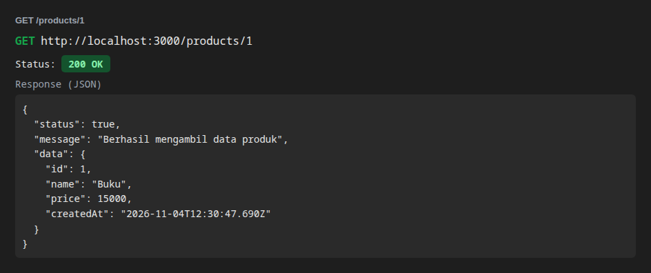
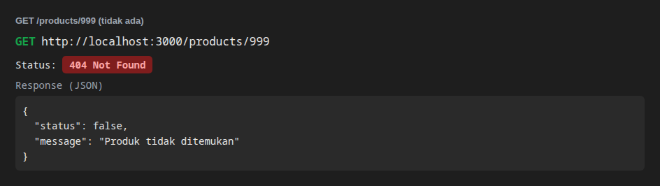
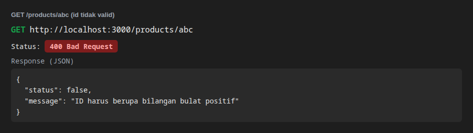

### POST /products

Database sebelum dan sesudah:

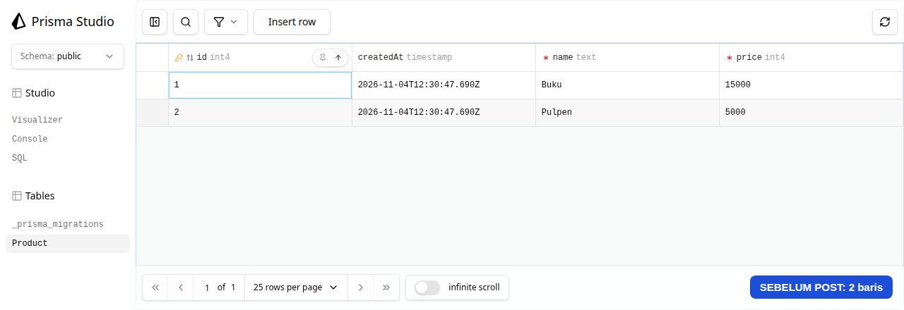
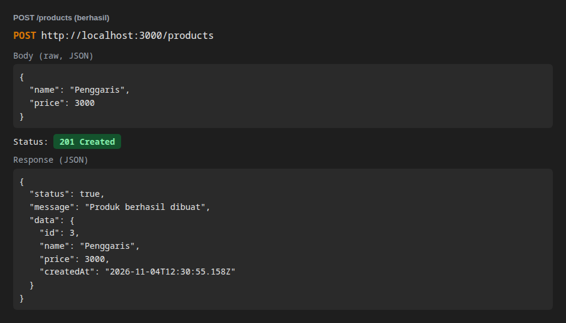
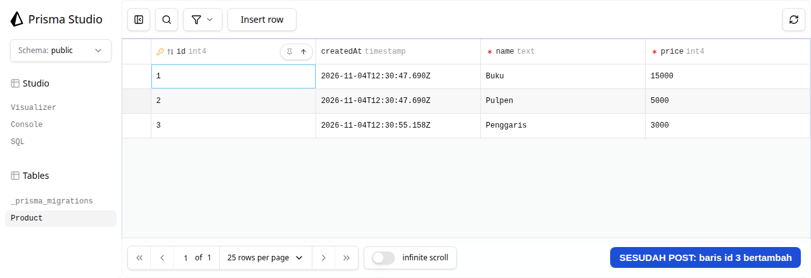

Skenario gagal (validasi):


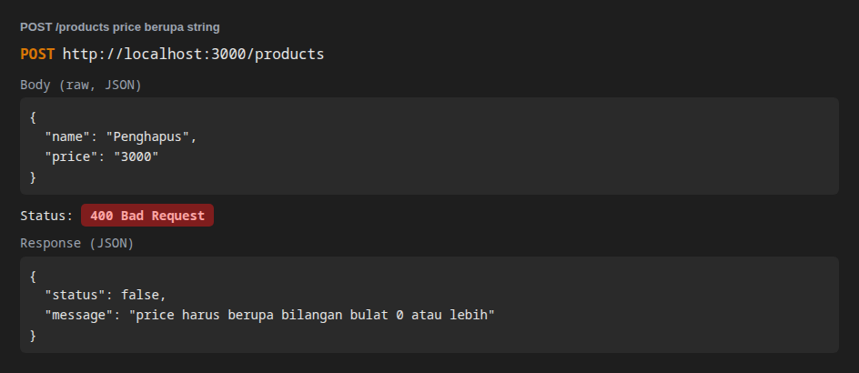
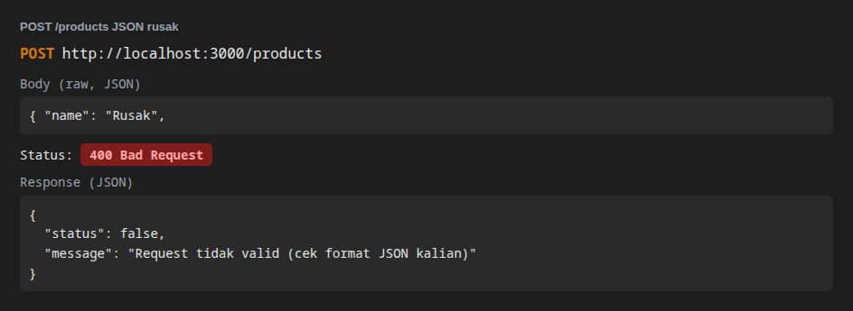

### PUT /products

Database sebelum dan sesudah:


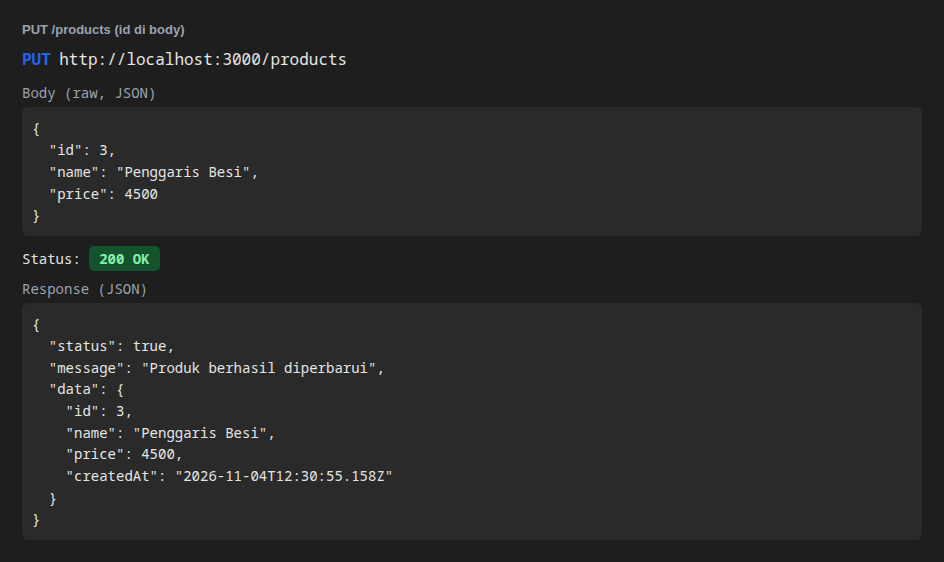
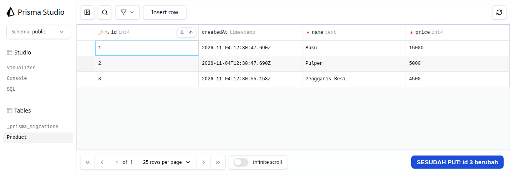

Skenario gagal:

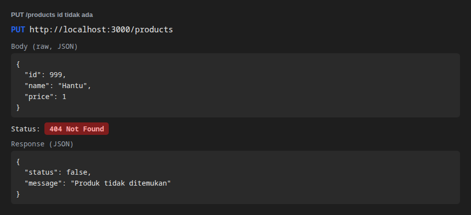
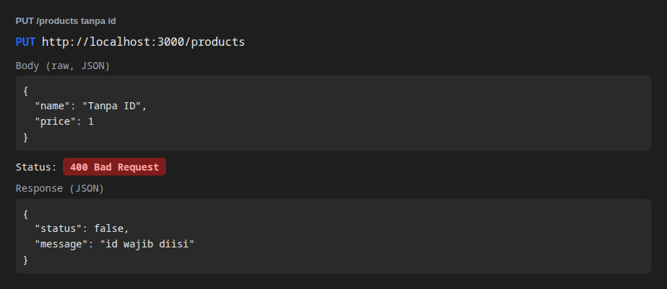

### DELETE /products/:id

Database sebelum dan sesudah:


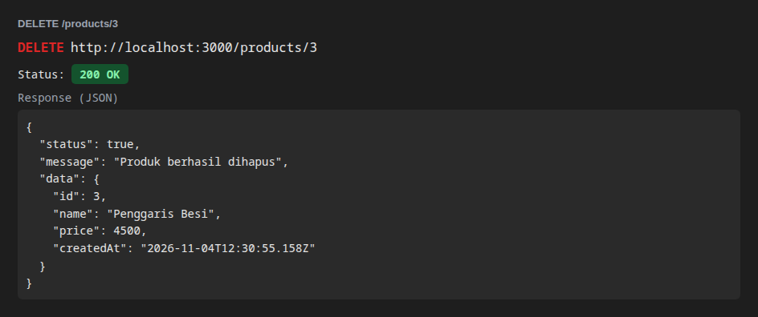
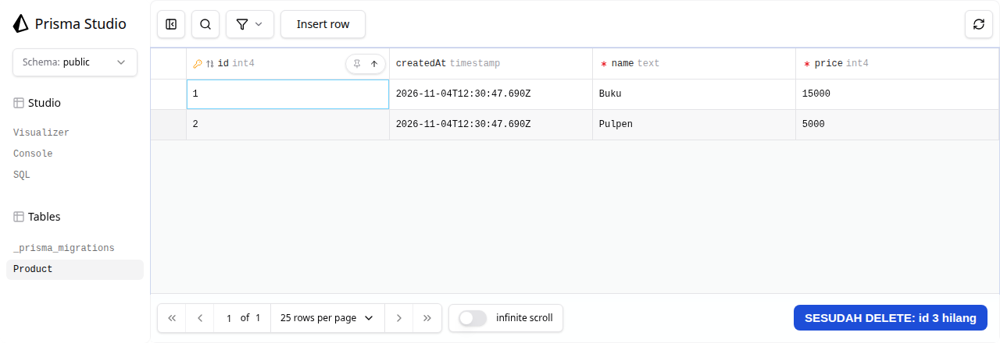

Skenario gagal:

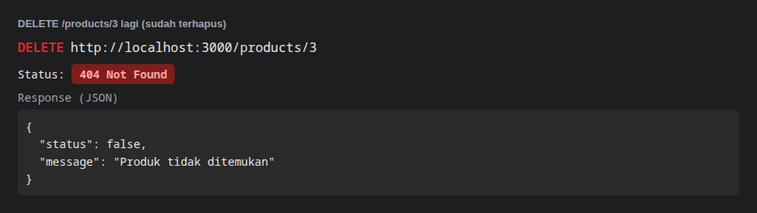

### Hasil run seluruh collection (19 request)
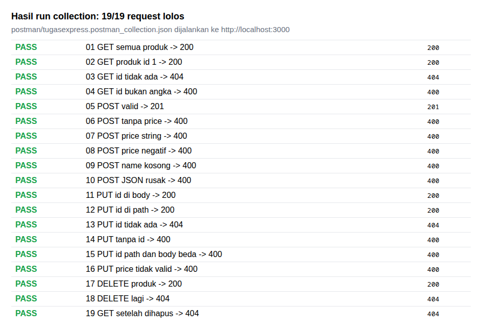
